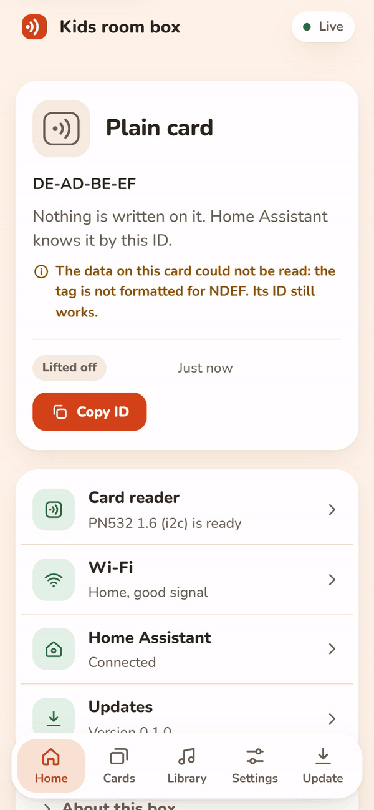
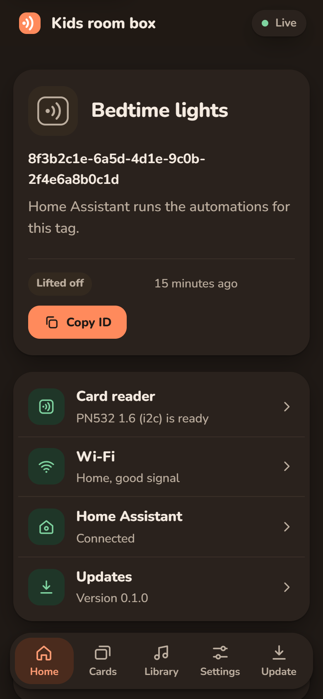
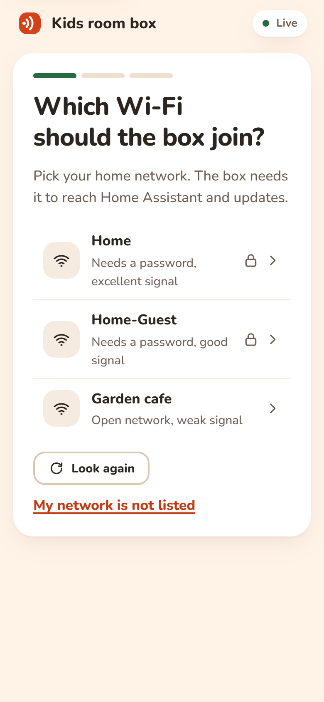
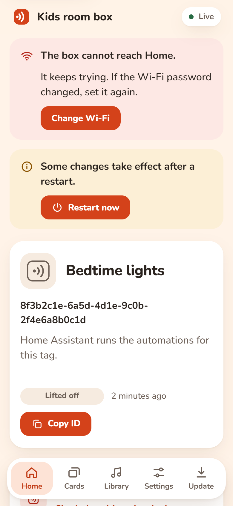
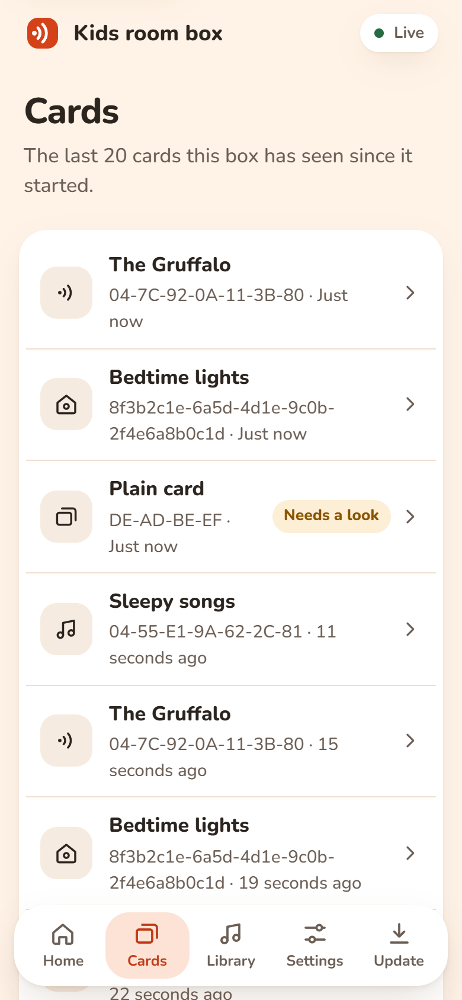

<p align="center">
  <picture>
    <source media="(prefers-color-scheme: dark)" srcset="docs/assets/logo-dark.svg">
    
  </picture>
</p>

<p align="center">
  Open firmware for ESP32 NFC readers: a Home Assistant tag reader, a kids' music box and a card
  writer in one binary, set up entirely from a phone.
</p>

<p align="center">
  <a href="https://github.com/fzn0x/tapwave/actions/workflows/ci.yml"></a>
  <a href="LICENSE"></a>
  
  
</p>

<p align="center">
  
</p>

Tap a card on the reader and the box's web page shows it straight away: what is written on it, its
ID and what will happen. Home Assistant gets the same scan as a tag, ready for automations. The
recording above is the real web UI running against the mock box in
[`scripts/mock_device.py`](scripts/mock_device.py).

## Status

Tapwave is built in four milestones. **Milestone 1, the tag reader, is code complete:** it builds
for every board and passes every test in CI, and has not yet been through a test on real hardware.

| Milestone | What it adds | State |
| --- | --- | --- |
| 1 | Wi-Fi setup, PN532 and RC522 auto-detection, NDEF and UID reads, MQTT with Home Assistant discovery, live web UI, updates from the web UI and Home Assistant | Code complete, awaiting a hardware test |
| 2 | Writing cards, a card table that maps IDs to actions, `tapwave://` actions, Home Assistant and Music Assistant playback | Planned |
| 3 | Local audio from SD cards and web radio, a `media_player` entity, kids mode (volume limit, sleep timer), buttons and rotary encoder | Planned |
| 4 | Bluetooth audio, PN5180, ESP32-S3 as a tested board, resume per card | Planned |

The [feature matrix](ARCHITECTURE.md#17-feature-matrix) compares Tapwave with ESPuino, Phoniebox,
TonUINO and adonno/tagreader, with an honest "not yet" column.

## What works today

- **Readers:** PN532 over I2C or SPI and RC522 over SPI, detected at boot. No reader is chosen at
  build time, and a loose wire can be fixed without a restart.
- **Cards:** NTAG213/215/216, MIFARE Ultralight and MIFARE Classic (read). NDEF URI, Text and MIME
  records are decoded; cards without NDEF report their UID in the same format as ESPHome and
  adonno/tagreader, so existing Home Assistant tags keep working.
- **Wi-Fi setup** three ways: a setup network with a captive portal, Improv over USB serial and
  Improv over Bluetooth LE (Home Assistant offers to set the box up).
- **Home Assistant** through MQTT discovery: a tag scanner that fires `tag_scanned`, last tag,
  tag present and tag events, buzzer and LED switches, restart and identify buttons, a firmware
  update entity and diagnostics.
- **Web UI** served by the box, with no internet needed: the last card tapped (live), health of
  the reader, Wi-Fi, Home Assistant and updates, recent cards, every setting with pins behind
  Advanced, and an Update page. Light and dark, phone first.
- **REST API and WebSocket** for everything the web UI does. See
  [section 13](ARCHITECTURE.md#13-http-api-and-websocket).
- **Updates** by uploading a file, from Home Assistant, or from the release manifest (each image
  checked against its SHA-256), with automatic rollback if a new version never gets online.
- **Pins are settings.** Every GPIO is chosen in the web UI and checked against the chip before it
  is saved.

<table>
  <tr>
    <td></td>
    <td></td>
    <td></td>
    <td></td>
  </tr>
</table>

## What you need

- An ESP32 board with at least 4 MB of flash. A WROVER module (with PSRAM) is the main target;
  WROOM boards work as tag readers. ESP32-S3 boards build too and become a tested target in
  milestone 4.
- A PN532 (I2C or SPI) or RC522 (SPI) reader module.
- Optional: a WS2812 LED and a passive buzzer for feedback.

Default pins, all changeable later in the web UI under Settings, Wiring:

| Signal | ESP32 | ESP32-S3 |
| --- | --- | --- |
| I2C SDA / SCL (PN532 in I2C mode) | 21 / 22 | 8 / 9 |
| SPI SCK / MISO / MOSI | 18 / 19 / 23 | 12 / 13 / 11 |
| Reader chip select (SPI) | 5 | 10 |
| LED, buzzer, reset, IRQ | not connected | not connected |

The [wiring guide](docs/wiki/Hardware.md) has diagrams for each reader.

## Getting started

1. **Flash** with [PlatformIO](https://platformio.org). Pick the environment for your flash size
   (`esp32-4mb`, `esp32-8mb`, `esp32-16mb` or `esp32s3`) and write both the firmware and the web UI:

   ```sh
   pio run -e esp32-4mb -t upload
   pio run -e esp32-4mb -t uploadfs
   ```

   Prebuilt images for every board are attached to each CI run; see
   [Flashing](docs/wiki/Flashing.md) for flashing them with esptool.

2. **Connect it to Wi-Fi.** Join the network `Tapwave-XXXX` from a phone and follow the setup
   page, or use Improv: Home Assistant's Improv via BLE integration, or
   [improv-wifi.com](https://www.improv-wifi.com) over USB.

3. **Open the box** at `http://tapwave-xxxxxx.local` (the setup page shows the exact address) and
   tap a card.

4. **Add Home Assistant** in Settings, Home Assistant: enter the MQTT broker and the box appears
   in Home Assistant under Settings, Devices and services. Tapped cards show up under Settings, Tags.

The [wiki](docs/wiki/Home.md) covers each step in detail, plus
[Home Assistant](docs/wiki/Home-Assistant.md), [MQTT](docs/wiki/MQTT.md),
[the REST API](docs/wiki/REST-API.md) and [troubleshooting](docs/wiki/Troubleshooting.md).

## Moving from adonno/tagreader

UIDs and Home Assistant tag IDs are reported in the same format, so existing tags and automations
keep working. `tag_ok`, `tag_ko` and `play_rtttl` have MQTT equivalents. Writing tags from Home
Assistant arrives in milestone 2. Details are in
[section 12](ARCHITECTURE.md#moving-from-adonnotagreader).

## Development

No board is needed to work on the web UI or the core logic:

```sh
python scripts/mock_device.py              # the web UI against a pretend box on http://localhost:8080
python scripts/mock_device.py --scenario setup     # or: problems
pio test -e native                         # C++ unit tests on this computer
cd ui && npm test                          # web UI tests (Node 24, no dependencies)
python -m unittest discover -s scripts/tests       # build script, mock box and smoke test tests
python scripts/smoke_test.py tapwave-a1b2c3.local --tap 30   # check a flashed box end to end
```

[ARCHITECTURE.md](ARCHITECTURE.md) explains how the firmware is put together, including the
driver interfaces, the [`tapwave://` URI scheme](ARCHITECTURE.md#9-the-tapwave-uri-scheme) and
the MQTT topics. [DESIGN.md](DESIGN.md) records the web UI's design system and
[PRODUCT.md](PRODUCT.md) who it is for.

## Contributing

Contributions are welcome, from a typo fix to a new reader driver. A new reader is
[one new file](docs/wiki/Adding-a-Reader.md). Start with [CONTRIBUTING.md](CONTRIBUTING.md), and
please follow the [code of conduct](CODE_OF_CONDUCT.md). Security issues go to
[SECURITY.md](SECURITY.md), not the issue tracker.

## Acknowledgements

Tapwave draws on ideas from [ESPuino](https://github.com/biologist79/ESPuino),
[TonUINO](https://www.voss.earth/tonuino/), [Phoniebox](https://phoniebox.de) and
[adonno/tagreader](https://github.com/adonno/tagreader). It uses
[ArduinoJson](https://arduinojson.org) (MIT), [NimBLE-Arduino](https://github.com/h2zero/NimBLE-Arduino)
(Apache-2.0), [doctest](https://github.com/doctest/doctest) (MIT) for tests and the
[Nunito](https://github.com/googlefonts/nunito) typeface (SIL Open Font License).

## License

[MIT](LICENSE)
